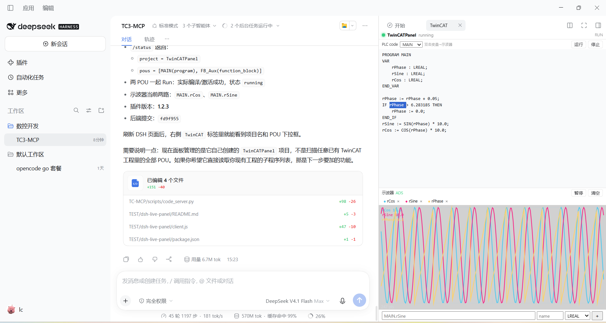

> **A note from the author**
>
> I'm an automation and control engineer with 13 years of experience, mostly on
> Beckhoff TwinCAT systems. Every line of code in this repository was written by
> AI, and the project is still an early draft — yet it already writes PLC code
> that makes me feel outclassed, and it drives TwinCAT 3.1.4026.27 entirely on
> its own.
>
> My goal is a fully automated programming system that never requires TwinCAT 3
> to be opened by hand — the same way I haven't opened Visual Studio in years.
> I'll let you know when I get there. Until then: enjoy what AI makes possible,
> before it takes your job.

---

# TC-MCP — TwinCAT 3 MCP servers

Two MCP servers for TwinCAT 3:

- `mcp_server.py` — read-only knowledge server over the local official PDF
  store (`search`, `get_document`, `status`).
- `automation_mcp_server.py` — `tc-auto`, a local XAE/ADS automation server
  (project create/build/activate, PLC source, ADS reads/writes, snapshots,
  load-control example).

The automation layer is a small ports-and-adapters package under `automation/`
(Python 3.15, pywin32 + pyads). It owns one local XAE instance and one ADS
session at a time and targets the local UM simulation
(`127.0.0.1.1.1:851`).

## DSH live panel



The right sidebar shows the editable PLC source with its POU selector and
run/stop controls above a live ADS scope with pause, clear, and add-variable
controls. The panel talks to `scripts/code_server.py` and
`scripts/scope_stream.py`.

## Requirements

- TwinCAT 3.1.4026.27 (XAE/XAR)
- Python 3.15 with `pypdf`, `pywin32`, `pyads`
- Node.js 26 (only for the optional browser/CDP helpers)
- A valid TwinCAT license for the packages you use (MC3 needs TC3 MC3 Base/Axis)

## Quick start

```powershell
python -m pip install --user -r requirements.txt
python -m app.cli doctor
python -m app.cli status
python -m app.cli search "MC_LoadControl"
```

Start the knowledge server:

```powershell
python mcp_server.py
```

Start the automation server:

```powershell
python automation_mcp_server.py
```

## Layout

```text
app/                      knowledge base (PDF store, SQLite FTS5, CLI)
automation/adapters/      XAE COM, ADS (pyads), dry-run, XML validation
automation/core/          project graph/model/config
automation/ports/         XAE/ADS/validator interfaces
automation/services/      session, runner, licensing, revisions, test plans
automation/examples/      load-control example
automation/observability/ live ("实操") event stream
config/                   sources, tool profiles, automation config
templates/minimal/        small TwinCAT project used by the runner
mcp_server.py             knowledge MCP server
automation_mcp_server.py  tc-auto MCP server
```

## Live mode (实操模式) / Silent mode (静默模式)

Silent mode (静默模式) is the default: no extra output and no event file.

To watch an automatic run, start the dashboard and enable live mode:

```powershell
python scripts/live_dashboard.py --port 8765
$env:TC_MCP_MODE = "live"
python your_automation_script.py
```

Open <http://127.0.0.1:8765>. Every `write_pou` / `write_dut` / `write_gvl`
event carries the exact declaration and implementation before it is sent to
TwinCAT; `build`, `activate`, `ads_write`, retries, snapshots and archive
exports are shown as separate steps. Events are appended to
`runtime/live/events.jsonl` (`TC_MCP_LIVE_LOG` overrides the path).
`TC_MCP_LIVE_CODE=0` suppresses the console code preview.

Prefer a terminal UI? Run instead:

```powershell
python scripts/live_tui.py
```

Keys: `↑/↓` select, `PgUp/PgDn` scroll code, `Tab` switch pane, `f` follow,
`q` quit. It uses the same event log and needs no extra packages.

## Scope

- Local UM simulation only; hardware activation stays manual.
- No safety-project writes.
- One XAE/one ADS session at a time.

## License

MIT — see `LICENSE`. Third-party notices are in `THIRD_PARTY_NOTICES.md`.
